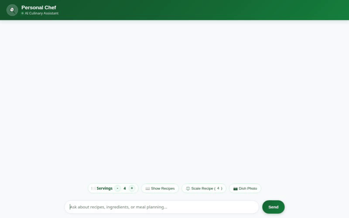

# Personal Chef 🍳

An intelligent AI culinary assistant and personal recipe companion powered by the **Google Agent Development Kit (ADK)**, **Gemini models**, and **Google Cloud Agent Platform**.



---

## 🌟 Overview

**Personal Chef** helps home cooks, meal planners, and food enthusiasts discover, manage, scale, and visualize delicious recipes. It integrates long-term memory to strictly respect user food allergies and dietary preferences across sessions, dynamically scales ingredient portions using a Python code execution sandbox, generates appetizing dish photography and cooking videos, and locates nearby grocery stores for ingredients.

---

## 🛠️ Implemented Features & Tools

The agent is powered by `app/agent.py` and implements the following tools and capabilities:

### 🧠 Cross-Session Memory (Vertex AI Memory Bank)
- **`PreloadMemoryTool` & Memory Callback**: Automatically remembers user dietary restrictions, food allergies (e.g. gluten, nuts, dairy), and ingredient preferences across conversations using Vertex AI Memory Bank.

### 📚 Firestore Recipe Management
- **`list_recipes`**: Searches and lists recipes stored in Google Cloud Firestore by keyword, category, or cuisine.
- **`get_recipe`**: Retrieves full recipe instructions and ingredients by recipe ID from Firestore.
- **`add_recipe`**: Saves new custom recipes to the user's personal Firestore database.

### ⚖️ Code Sandbox Portion Scaling
- **`scale_recipe_ingredients`**: Uses ADK's Python Code Execution Sandbox to execute exact mathematical calculations for scaling recipe ingredients up or down for any number of servings.

### 📸 Multimodal Media Generation (Vertex AI & Cloud Storage)
- **`generate_dish_image`**: Generates gourmet food photos using `gemini-3.1-flash-lite-image`.
- **`generate_dish_video`**: Generates short cooking video clips using Google's Omni model (`gemini-omni-flash-preview`) in the `global` region.
- **Cloud Storage Persistence**: Saves media as session artifacts and uploads files directly to Google Cloud Storage (GCS), returning public HTTPS URLs for inline rendering.

### 🌐 Global Recipe Search & Location Services
- **`search_online_recipes`**: Searches global online recipes via TheMealDB API.
- **`geocode_address`**: Converts physical addresses to geographical coordinates using the Google Maps Geocoding API.
- **`find_nearby_places`**: Locates nearby supermarkets and grocery stores using the Google Maps Places API (New).

### 🎨 Structured A2UI & Custom Web Frontend
- **A2UI Rendering**: Formats responses into structured card UI components (cards, rows, text, images) using `A2uiSchemaManager`.
- **Custom Web Interface**: Modern culinary chat UI built with FastAPI and Vanilla JS, featuring a **Servings Counter Widget** and **Read Aloud (Text-to-Speech)** voice support.

---

## 🚀 Planned / Future Enhancements

The following features were outlined during initial design but are **planned, not yet implemented**:

- 🗓️ **Meal Plan Calendar Export**: Exporting weekly meal plans to Google Calendar (*planned, not yet implemented*).
- 🛒 **Automated Shopping List PDF**: Exporting combined grocery shopping lists to PDF (*planned, not yet implemented*).

---

## ☁️ Google Cloud Infrastructure & Architecture

- **Reasoning Model**: Gemini 2.5 Flash (`gemini-2.5-flash`)
- **Image Generation Model**: Gemini 3.1 Flash Lite Image (`gemini-3.1-flash-lite-image`)
- **Video Generation Model**: Gemini Omni Flash Preview (`gemini-omni-flash-preview` in `global` region)
- **Long-Term Memory**: Vertex AI Memory Bank
- **Database**: Google Cloud Firestore
- **Media Hosting**: Google Cloud Storage (GCS) Public Bucket
- **Code Execution**: ADK Built-in Python Sandbox
- **API Standards**: A2A Protocol & A2UI 0.8 Schema

---

## 💻 Local Setup & Execution

### Prerequisites

Ensure you have installed:
- [uv](https://docs.astral.sh/uv/) (Python package manager)
- Google Cloud SDK (`gcloud`)
- [google-agents-cli](https://cloud.google.com/vertex-ai/generative-ai/docs/agent-engine/overview)

### 1. Environment Configuration

Set your target GCP Project ID and optional Maps API key in your terminal:

```bash
export GOOGLE_CLOUD_PROJECT="your-gcp-project-id"
export GOOGLE_CLOUD_LOCATION="us-east1"
export GOOGLE_MAPS_API_KEY="<your_api_key>"
```

### 2. Install Project Dependencies

```bash
uv sync
```

### 3. Run the Agent Locally (ADK Playground)

To test the agent with the default ADK developer UI:

```bash
uv run adk web app
```

### 4. Run the Web Frontend & Proxy

To launch the custom web chat interface locally:

```bash
cd frontend
PORT=8080 uv run python main.py
```

Then open your browser to the local server port configured in your environment.
